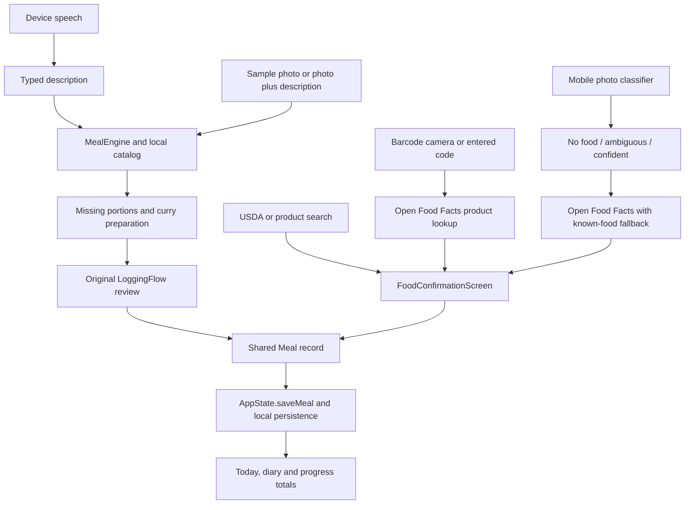

# Kayleo project guide

Reviewed against the workspace on 8 October 2026. This is a source-based map of the current application, compared with the two supplied planning PDFs. Planned capabilities are not treated as implemented features or as authorization to implement them.

## Product and intended direction

Kayleo is a Flutter calorie and macronutrient tracker with camera, typed descriptions, and device speech input. Its intended advantage is low-friction meal logging: identify food, resolve important uncertainty, let the user correct portions and preparation, calculate nutrition, confirm the meal, and immediately update daily feedback.

The product blueprint describes three separate responsibilities: food identification; recipe/portion understanding; and deterministic nutrition calculation. The data-strategy document expands this into a food ontology, authoritative nutrition records, food-specific serving conversions, mobile models, weighed-meal evaluation, and consented correction data. Both documents emphasize regional foods and learning familiar meals.

The current implementation is an interactive local prototype with a mobile classifier and network food lookup added to it. It has substantial working tracking/UI behavior, but it does not yet implement the full intelligent meal-understanding system.

## Repository map

| Location | Responsibility |
|---|---|
| `lib/main.dart` | Startup, 1.5-second splash, demo-session restoration, authentication/onboarding/shell selection, global appearance, navigator reset between identities |
| `lib/core/app_state.dart` | Shared mutable application state, derived totals, persistence queue, recovery backups, meals/templates, hydration, weight, activity, preferences and local community state |
| `lib/core/auth_repository.dart` | `AuthRepository` interface and local `DemoAuthRepository`; email-based account separation and legacy-data assignment |
| `lib/core/meal_engine.dart` | Deterministic description parsing, food aliases, quantities, meal times, portion questions and curry preparation rules |
| `lib/core/ui.dart` | Reusable panels, sheets, buttons, branding, photos, progress rings and theme helpers |
| `lib/core/nutrition_view.dart` | Shared calorie/protein/carbohydrate/fat display definitions and progress calculation |
| `lib/data/models.dart` | Nutrients, foods, meal items, meals, body profiles, weight and drink entries; JSON conversion |
| `lib/data/food_database.dart` | 30 illustrative local food entries and the shared item/meal nutrition calculator |
| `lib/features/auth.dart` | Demo login/registration forms |
| `lib/features/onboarding.dart` | Three introductory pages, goal, adult body profile, routine/preferences, target plan, optional sample week |
| `lib/features/shell.dart` | Adaptive navigation, shared scrolling, storage-error banner and rule-based reminder inbox |
| `lib/features/dashboard.dart` | Today totals, logging actions, macro bars, meals, consistency and daily notes |
| `lib/features/logging.dart` | Input routing and original draft/clarification/review/save workflow; device speech, manual nutrition, local food picker and meal memory |
| `lib/features/meal_camera.dart` | Camera hardware/session lifecycle, capture/retake, lens and flash controls, permission/retry and background handling |
| `lib/screens/food_camera_screen.dart` | New classifier-driven scanner, ambiguity selection, nutrition lookup and `FoodConfirmationScreen` |
| `lib/screens/food_lookup_screen.dart` | Open Food Facts/USDA searches, product barcode scanning and lookup |
| `lib/features/portion_editor.dart` | Fractions, serving units, mass/volume conversions and the eaten share of a shared dish |
| `lib/features/diary.dart` | Date-aware diary, filters, editing, repeat/delete/undo and saved meals |
| `lib/features/hydration.dart` | Quick water logging, drink ledger, editing/deleting/undo and water goal |
| `lib/features/progress.dart` | 7/30-day nutrient charts, weight trend, habits, badges and rule-based weekly review |
| `lib/features/settings.dart` | Profile/targets, appearance, preferences, reminders, privacy, export/reset, sign-out and premium preview |
| `lib/features/community.dart` | Opt-in sample groups/feed, locally stored interactions and meal posts |
| `lib/theme/` | Manrope typography, cream/forest/lime palette, spacing, radii and light/dark semantic surfaces |
| `lib/services/food_ai_service.dart` | Detector abstraction, PyTorch adapter, label/probability validation, scan thresholds, nutrition HTTP clients, short-lived search cache and rate limits |
| `lib/food_ai_service.dart` | Compatibility export of the service; not a second implementation |
| `packages/pytorch_lite/` | Vendored Android/iOS plugin override, including native model-release channel |
| `assets/` | Bundled photography, branding, font, TorchScript model and label mapping |
| `test/` | Existing unit and widget regression suites |
| `integration_test/food_model_test.dart` | Native model execution/resource-release probe; not an accuracy benchmark |
| `android/`, `ios/`, `macos/`, `web/`, `windows/`, `linux/` | Platform runners, branding, permissions and build configuration |
| `docs/`, `metadata/`, `tools/` | Previous design/research/verification reports, store listing and brand-asset generator |

There is no backend implementation, model-training pipeline, or populated USDA import in this workspace. `data/usda/` is empty. Build output, preview images and previous logs are supporting artifacts, not the source of current feature truth.

## Startup and navigation

`main()` initializes Flutter and starts `KayleoApp`. Without an injected test state, startup restores the local demo session while displaying the splash. Missing/signed-out sessions reach `AuthScreen`; authenticated accounts reach onboarding or `AppShell` depending on `onboarded`.

Desktop navigation exposes Today, Diary, Scan food, Progress, Saved meals, Community and You. At widths below 1050 pixels, the app uses mobile navigation with a central camera action and secondary destinations available through settings. Today is the landing screen; the camera starts after a scan action rather than at app launch.

Demo authentication is intentionally permissive. Passwords are validated for form length but never stored or compared. Sign-in can create an email entry locally; this is account selection for the prototype, not server authentication or a security boundary. Existing legacy data is reserved for the first account that claims it.

## Meal pipelines as implemented

All routes share the persisted `Meal` and the deterministic nutrient calculator. They currently use two distinct review experiences.

### Original text/voice/photo-description route

`showLogger()` routes text, voice and existing-meal editing into `LoggingFlow`. Voice recognition produces editable text. `MealEngine.parse()` normalizes some number words/fractions, matches catalog aliases using word boundaries and longest overlapping matches, extracts quantities and AM/PM times, handles yesterday, and chooses a meal category.

Unspecified portions generate an item-specific question. Rice has cup choices; other foods use standard/half/1.5-times serving choices. Curry can add a preparation question; rich restaurant-style adds an illustrative 10 g oil adjustment. The current engine does not rank questions by expected nutritional impact or cap them at two: rice and curry can produce three questions, and more unspecified foods can produce more.

Sample photos map to predefined descriptions. Gallery photos in the original panel can still use a user description. Camera capture can route into the newer classifier screen. Meal memory supports yesterday's breakfast and matching saved templates, but does not learn portion priors automatically.

The original review supports changing foods, portions, meal name, category, date/time, notes and assumptions. Saving replaces a matching meal ID; repeating creates a new record. Drafts use copies so editing does not immediately mutate the saved meal.

### Classifier and database route

`PytorchFoodDetector` supports Android/iOS, loads `food_edge_detector_500.pt` at 224 by 224 input size, and applies stable softmax to plugin output. Despite the asset filename, the metadata and mapping describe 530 output labels. Label index 0 must be `non_food`; label indices must be contiguous.

`FoodAIService.scanMeal()` serializes inference and checks image size, output length, finite probabilities and their sum. Top class `non_food` or probability below 0.40 gives `noFood`; probability below 0.70 or a top-two gap below 0.20 gives `ambiguous`; otherwise it gives `confident`. These are heuristic thresholds, not certified calibration.

This is a single-image classifier returning candidate labels. There is no implemented multi-item detector/segmenter, ingredient dissection, geometry/depth estimation or photo-derived portion mass. The confirmation screen begins at 100 g/ml and asks the user to adjust the amount.

Recognition is local, but nutrition lookup normally uses Open Food Facts. On request failure, known aliases can resolve to the illustrative catalog; unsupported foods fail rather than invent values. An empty successful search does not trigger this fallback. A single returned product goes directly to confirmation; multiple products require selection. Matching a dish label to a product search result is not verified recipe equivalence.

Search also offers USDA FoodData Central, with compile-time `USDA_API_KEY` and a default `DEMO_KEY`. Barcode uses `mobile_scanner` and Open Food Facts product lookup. Both are implemented integration paths; their real-device/live-network behavior was not tested in this review.

The service uses a 12-second request timeout, response-size checks, input validation, per-minute quotas and a bounded 10-minute in-memory search cache. The cache is not a persistent offline food database. Missing nutrients remain null; required values must be supplied before confirmation, with fiber optional.

## Data and calculation contracts

`Food` holds identity, aliases, nutrients per 100 units, standard serving size, source text/URL, barcode and mass/volume basis. `MealItem` holds the food ID, consumed amount, optional portion metadata and optional food snapshot. API-derived foods use snapshots so saved records can be calculated later without another request. Static catalog items usually retain only their ID.

`Meal` holds ID, name, date/time, category, items, optional photo bytes, input type, notes, assumptions and optional manual nutrient values. Photos become base64 within the JSON state record. Nutrients include calories, protein, carbohydrate, fat and nullable fiber.

`itemNutrition = food.per100g × consumed amount / 100`; meal totals sum items plus any manual nutrients. Daily totals select meals by local calendar day. Unknown fiber propagates as unknown rather than a fabricated zero. Fields named `grams`/`per100g` also carry ml-based entries when `nutritionBasisUnit` is `ml`; changes must preserve this distinction.

Portion editing supports decimals, simple/mixed fractions, ounces, fluid ounces and food-specific serving units. Shared dishes multiply the total by the consumed share. Direct amount edits clear stale portion metadata. The parser's household-unit handling is more limited than the editor: many recognized units multiply by the food's default serving weight rather than resolving a full unit-specific conversion table.

Body targets use a Mifflin-style resting-energy equation with activity factors, a +/-250 kcal goal adjustment, a 1500-4500 target clamp, weight-based protein, 28% of calories for fat, and carbohydrate from the remainder. These are prototype starting estimates. Weight logging updates profile weight without automatically recalculating targets.

Hydration uses individual `DrinkEntry` records, with daily `water` totals derived from that ledger. Legacy daily totals migrate into synthetic drink entries. Weight keeps one record per local date. Activity is a manually entered daily minute total. Progress averages include only days with meal records; incomplete logs can therefore lower the reported intake.

## Persistence and offline boundaries

`AppState` is a `ChangeNotifier`; the root listens to it and rebuilds the app. Mutations generally call `persist()`, which notifies the UI, snapshots JSON and serializes writes. Failed writes retain in-memory data and expose `storageError`; persistence absorbs the error, so callers must inspect that state rather than assume an awaited save was durable.

State uses SharedPreferences, schema version 2, and account-specific keys. Legacy `nouri_state_v1` and `nouri_recovery_backup_v1` intentionally remain for compatibility. Bad records are preserved in a recovery key and replaced with clean in-memory state. Some hydration/schema compatibility is implemented, but there is no general database migration framework.

Local logging, nutrition math, diary, templates, water, weight, activity and basic analytics work without app-server access. Mobile classification uses bundled assets. Voice depends on the device provider; online food search/barcode nutrition requires connectivity; barcode web decoding can involve a web reader dependency. A loaded web app can use local state, but there is no reviewed cold-launch offline cache guarantee.

Storage is one unencrypted JSON blob per account, including retained photos. It is not transactional health storage, durable multi-device sync, or encrypted account separation. The original upload path caps photos at 2 MB; the recognition service allows images up to 10 MB, so a universal retained-photo limit is not enforced consistently. Export exists; backup import/restore and sync queues do not.

## Working features versus future capabilities

| Capability | Current behavior | Remaining part of the vision |
|---|---|---|
| Tracking | Editable meals, daily macros, date-aware diary, saved meals | Richer production food coverage |
| Text/voice | Local parser and device speech | Broader language understanding and consistently offline speech |
| Photos | Camera hardware, local mobile classifier, description/demo route | Multi-food recognition, ingredients, measured portions and calibrated confidence |
| Nutrition | 30 local foods; OFF/USDA API paths; saved food snapshots | Versioned authoritative offline catalog and validated regional recipes |
| Clarification | Per-item portion questions and curry preparation | Nutritional-impact ranking and measured question/value tradeoff |
| Personalization | Profile targets, templates, previous breakfast | Learned routines, portion priors and structured correction history |
| Habits | Water, weight, manual activity, streaks, badges, rule-based review | Wearables/health APIs and adaptive coaching |
| Reminders | Preferences and in-app inbox | Scheduled/background notifications and delivery timing |
| Identity | Local permissive demo accounts | Real authentication, recovery and backup/sync |
| Community | Local sample feed and interactions | Real users, server posts and moderation |
| Premium | Local preview toggle and illustrative plans | Purchases, entitlement verification and restore |
| Privacy | Retention preference, photo/data deletion and JSON export | Encrypted database, durable restore and consented data processing pipeline |
| Model/data operations | Bundled artifact, labels and minimal metadata | Training provenance, frozen benchmarks, downloadable/versioned packs and updates |

## Documentation discrepancies

The README and older reports describe the application before the newer auth, classifier, lookup and hydration/portion work. In particular:

- README/WORKFLOWS say no login, simulated-only photo recognition and demo-only barcode lookup. The current source contains demo login, mobile classifier inference and real API/barcode paths.
- Settings privacy copy says there is no account, and About still groups photo recognition/live barcode lookup with previews. Onboarding also describes recognition as a preview. These need clarification against current platform behavior.
- Earlier documentation says clarification is zero to two questions; the current parser can ask about every missing portion plus preparation.
- `docs/VERIFICATION.md` reports 42 tests and a clean analyzer for a previous version. This review observed 82 passing tests and four current analyzer import issues.
- Existing screenshots and build artifacts may represent earlier versions; they cannot establish that current native inference or external APIs work.

This review adds the project guide only. It does not silently change product copy, existing reports or application behavior.

## Verification on 8 October 2026

- `flutter test --no-pub`: all 82 tests passed.
- `flutter analyze --no-pub`: four issues, all test imports: unnecessary `dart:typed_data` in `test/food_ai_service_test.dart`; unused `dart:typed_data`, `data/models.dart` and `features/portion_editor.dart` in `test/food_camera_flow_test.dart`. No runtime-source diagnostics were reported.
- Native-model integration probe exists but was not run in this review. Widget/service tests use mocks and do not certify model accuracy or live API availability.
- No fresh release build, physical-device permission test, signed distribution build or browser session was performed.

The vendored Android runtime uses PyTorch 2.1.0; iOS declares LibTorch 1.13.0.1, while metadata says the model was exported with Torch 2.1.2. Cross-runtime compatibility needs native validation. Android still uses `com.example.calorie_app` and debug signing for release configuration.

## Practical direction for subsequent work

First reconcile documentation and product messaging with current platform behavior. Then define one shared analysis/review contract for camera, text, voice and search while preserving existing editing, hydration, snapshots and legacy-data compatibility.

For the intelligence roadmap, the supplied data strategy proposes authoritative nutrition/serving normalization separately from visual training. Food recognition, ingredient/attribute inference and portion estimation need different supervision. The missing differentiator is a question policy that combines uncertainty, likely nutrient change and user answerability, measured on real weighed meals before/after clarification.

The current metadata does not establish training dataset, license, model architecture, label accuracy or representative meal performance. A runtime load test and a passing widget suite should not be described as nutrition-accuracy validation. Dataset/license statements in the PDFs are planning references, not independently reverified claims from this review.

Production persistence, offline lookup packs, consented structured corrections and sync should be explicit architecture work. Live community and monetization remain later integrations; the most valuable core milestone is a trustworthy, fast meal-confirmation loop with verified food/portion data.
