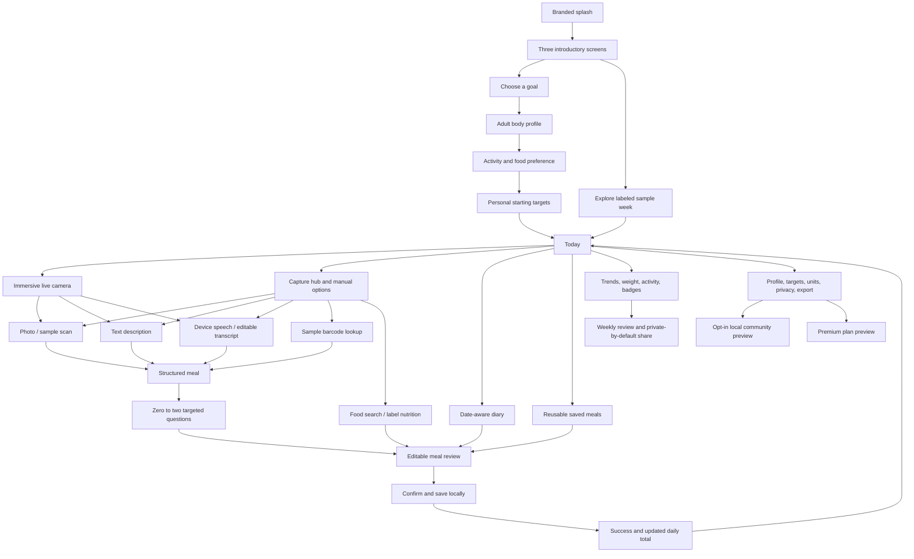

# Screen map and capability status

| Capability | Prototype behavior | External integration remaining |
|---|---|---|
| Splash and onboarding | Complete branded first-run journey, optional sample exploration | None |
| Body profile and targets | Validated adult inputs; editable starting targets | Clinical personalization and validated dynamic models |
| Photo input | Immersive central Scan and inline sample-plate camera on Android/iOS/web; capture, retake, switch lens, use photo; gallery selection; local retention; sample scan workflow | Trained vision |
| Text input | Local aliases, quantities, grams/ounces, common time phrases | Broad language understanding and unknown-food lookup |
| Voice input | Device recognition, transcript editing, fallback | Provider-dependent offline models and conversational follow-up |
| Clarification | Rice quantity and curry preparation, zero to two questions | General calibrated uncertainty/impact ranking |
| Nutrition | Deterministic portions; inspectable source labels; manual input | Verified regional/branded database |
| Editing | Food, portion, category, meal time/date, name, notes, missing ingredients | Live branded-food resolution |
| Diary | Daily groups, date picker, week navigation, search/category filters | Cross-device sync |
| Meal memory | Save, remove, review/repeat templates; yesterday's breakfast | Learned personalized portion priors |
| Water and movement | Local manual logs | Wearable/health APIs |
| Weight and progress | Local records; daily protein/carbs/fats target bars; calorie and macro averages and 7/30-day charts; weight trends; streaks | Long-term adaptive coaching |
| Weekly review | Summaries from local records, safe consistency sharing | Model-generated personalized analysis |
| Reminders | Saved preferences and contextual in-app inbox | OS scheduling and background delivery |
| Barcode | Enter/sample a clearly marked demo barcode | Camera scanning and product database |
| Community | Opt-in sample feed, group membership, likes, comments, local meal posts, hide/report preview, consistency challenge | Server, moderation, real users, uploads |
| Premium | Select plan and enable/disable demo state | Billing, entitlement verification, restore purchases |
| Privacy | Future-photo retention, consent preference, delete photos/data, JSON export | Encrypted production storage, backup restore, cloud retention |
| Login and registration | Excluded as requested | Outside this task |

## Data behavior

All immediate nutrition displays read from the same meal records. Editing a meal replaces its ID rather than adding a duplicate. Draft changes do not mutate stored meals before confirmation. A saved template is copied to a new ID/time when repeated. Dates use the device's local day. Quiet hours are a saved preference; background notification delivery is a preview.

Rows originating in the sample week have `input: Sample data`. The global sample-data badge remains visible when that sample week is loaded. Community sample counts and posts are illustrative. Local interactions never represent a server action.

Confirmations inside the product protect deletion and replacing existing sample/personal data. These are normal end-user flows in the app; no external action is performed by the development assistant.
